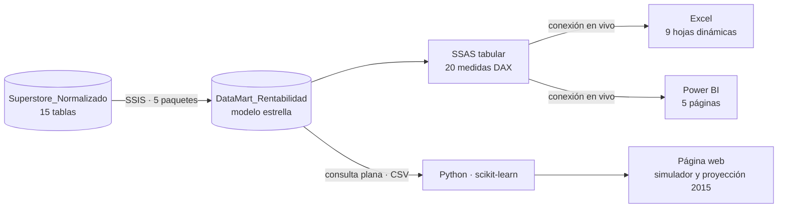
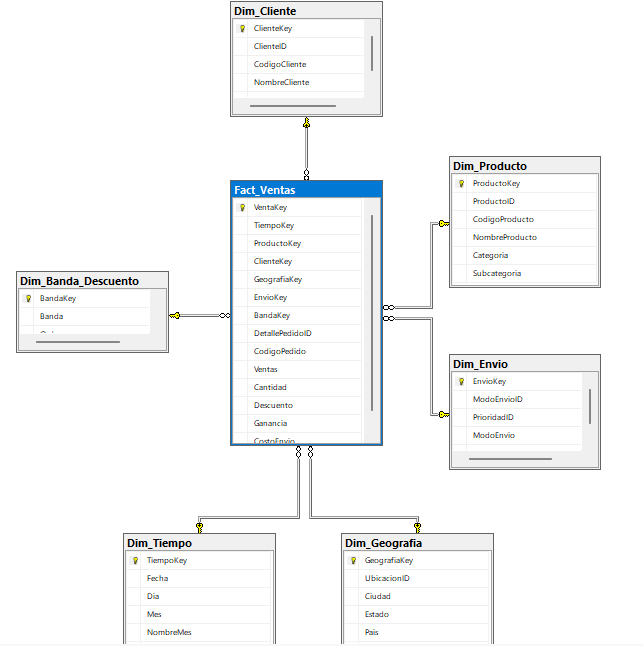
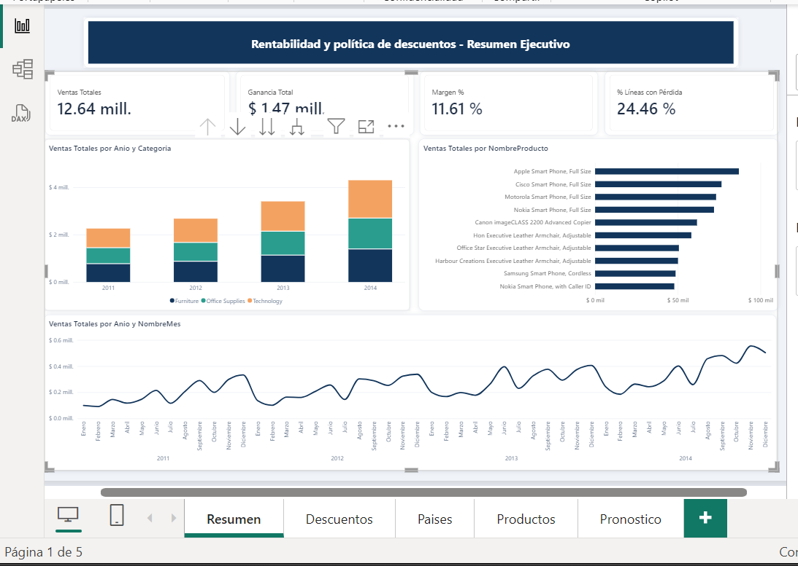
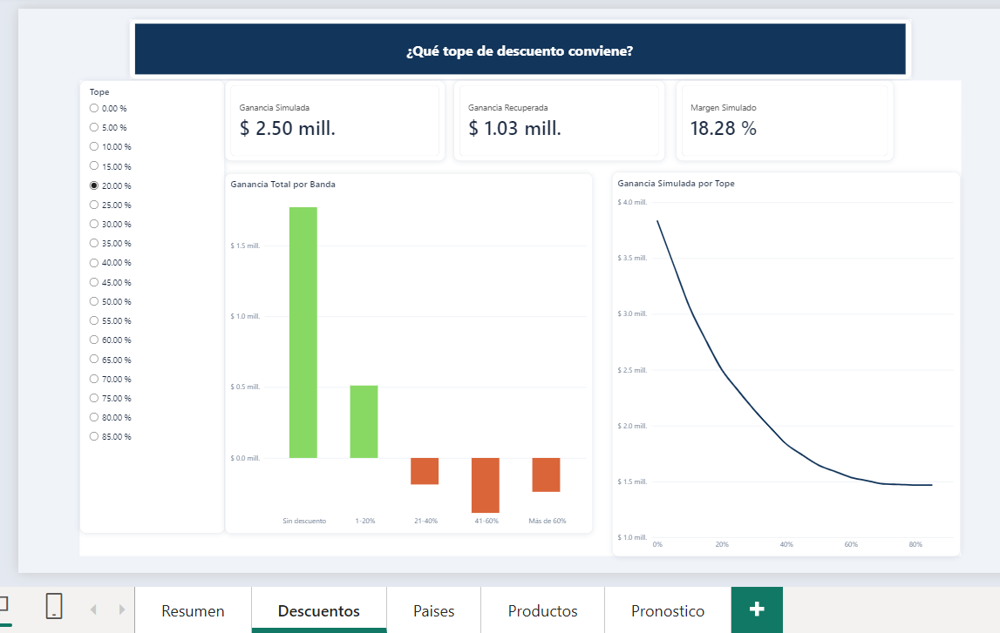
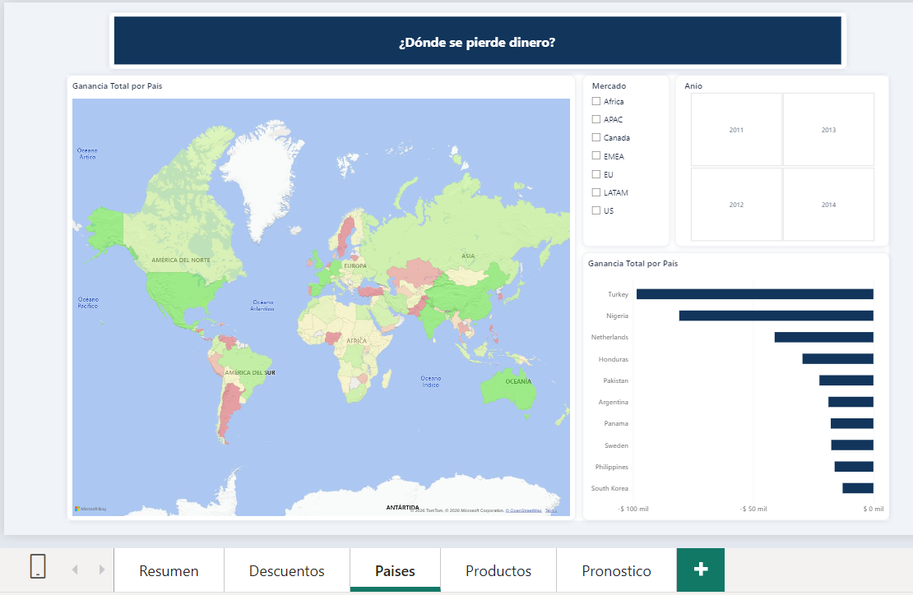
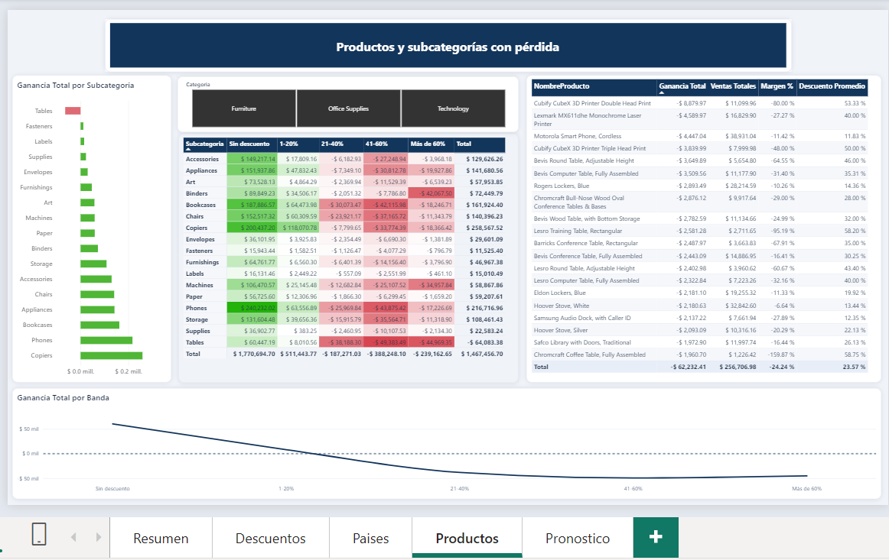
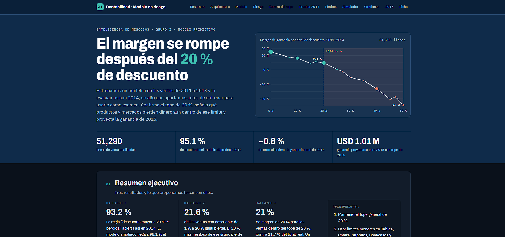
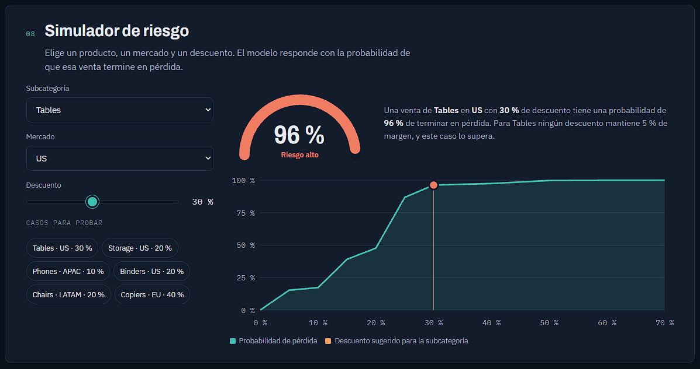
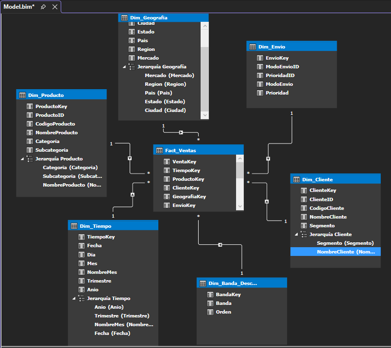
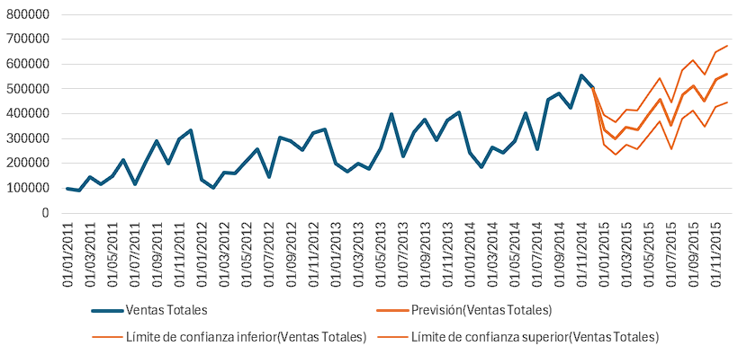

# Rentabilidad y política de descuentos

**¿Dónde ganamos y dónde perdemos?** Solución de Inteligencia de Negocios de punta a punta sobre 51,290 líneas de venta: DataMart en SQL Server, ETL con SSIS, modelo tabular en SSAS, tablas dinámicas en Excel, tablero en Power BI y un modelo predictivo en Python validado con datos que no vio.


> Proyecto del curso **Inteligencia de Negocios** (Sección 2), Escuela Profesional de Ingeniería de Software, Universidad Nacional Mayor de San Marcos · Grupo 3 · 2026.

**[Ver la página del modelo predictivo](https://claude.ai/artifact/R6rWUSvcHPMc2h8EcgG2Jr)** · **[Leer el informe completo (PDF)](docs/Informe_Final.pdf)**

---

## El problema

La empresa vende más cada año, pero **una de cada cuatro líneas de venta (24.5 %) pierde dinero**, y esas pérdidas suman USD −920,646. La gerencia comercial necesita saber:

> ¿Qué descuento máximo deberíamos permitir, y en qué productos y países?

## Resultados

| | |
|---|---|
| **Tope recomendado** | **20 %**. Toda venta con descuento mayor a 20 % da pérdida: en conjunto restan USD 814,682. |
| **Ganancia con el tope (2011–2014)** | De USD 1.47 M a USD 2.50 M y margen de 11.6 % a 18.3 % (techo, con volumen constante). |
| **Proyección 2015** | USD 592 mil sin política y USD 1.01 M con el tope. El modelo predictivo y el escenario de Excel coinciden con menos de 1.3 % de diferencia. |
| **Modelo predictivo** | 95.1 % de exactitud y AUC 0.990 al predecir 2014 entrenando solo con 2011–2013. |
| **Dónde actuar primero** | Tables (única subcategoría con pérdida), Turquía, Nigeria y Países Bajos; EMEA con margen de 5.45 %. |

## Arquitectura



### Modelo estrella

`Fact_Ventas` (una fila por línea de pedido) con seis dimensiones: `Dim_Tiempo`, `Dim_Producto`, `Dim_Cliente`, `Dim_Geografia`, `Dim_Envio` y `Dim_Banda_Descuento`. La dimensión de bandas existe porque la pregunta de negocio gira alrededor de cuánto descuento se concede.



## Capturas

| Power BI · Resumen | Power BI · Descuentos |
|---|---|
|  |  |
| **Power BI · Países** | **Power BI · Productos** |
|  |  |
| **Modelo predictivo · portada** | **Modelo predictivo · simulador** |
|  |  |
| **SSAS · modelo tabular** | **Excel · pronóstico 2015** |
|  |  |

## Lo más interesante técnicamente

- **Escenario "qué pasaría si" en DAX.** Una tabla calculada sin relaciones funciona como parámetro de tope, y una medida recalcula línea por línea la ganancia si ningún descuento superara ese tope (precio de lista = ventas / (1 − descuento); costo = ventas − ganancia).
- **Validación honesta del modelo.** Separación por tiempo (2011–2013 → 2014), comparación contra una regla simple y calibración de probabilidades. Conclusión incómoda pero valiosa: con las variables de la política, el modelo empata con la regla, lo que confirma que el descuento es la palanca principal.
- **Dos métodos, el mismo número.** La proyección 2015 calculada venta por venta con el modelo coincide con la del escenario agregado de Excel (+0.8 % y +1.3 %).
- **Problemas reales resueltos:** conexión del servidor de área de trabajo de SSAS (implementación por script TMSL desde SSMS), conteo de pedidos con códigos repetidos, página de códigos 1252 frente a UTF-8 al exportar, y CSV con comillas dentro del texto.

## Estructura del repositorio

```
├── sql/                  Scripts del DataMart, verificación, llaves, permisos y exportación
│   └── etl_origenes/     Consulta de origen de cada paquete SSIS
├── ssis/                 Proyecto Integration Services (ETL_DataMart_Rentabilidad)
├── ssas/                 Modelo tabular completo en TMSL (.xmla) y consulta DAX de verificación
├── excel/                Libro de tablas dinámicas conectado al modelo
├── powerbi/              Tablero (.pbix) y tema personalizado (.json)
├── modelo_predictivo/    Cuaderno de Colab y página web del modelo
├── docs/                 Informe final en PDF y capturas
└── data/                 Origen de los datos (Kaggle)
```

## Cómo reproducirlo

1. Restaurar `Superstore_Normalizado` en SQL Server (creada desde [Global Superstore](https://www.kaggle.com/datasets/shekpaul/global-superstore)).
2. Ejecutar `sql/01_crear_datamart.sql` y `sql/02_cargar_dim_tiempo_y_bandas.sql`.
3. Ejecutar los paquetes SSIS (dimensiones primero, `ETL_Fact_Ventas` al final) y verificar con `sql/03_verificacion_carga.sql`.
4. Crear las llaves con `sql/04_llaves_foraneas.sql` y dar permiso al servicio de SSAS con `sql/05_permiso_servicio_ssas.sql`.
5. Implementar el modelo ejecutando `ssas/ModeloBI_Rentabilidad.xmla` en SSMS (consulta XMLA).
6. Abrir el libro de Excel y el tablero de Power BI apuntando a `localhost`.
7. Para el modelo predictivo: exportar con `sql/06_exportar_para_modelo.sql` y ejecutar el cuaderno.

## Equipo · Grupo 3

- Castro Contreras Luis Alejandro ([@RedSteinYT](https://github.com/RedSteinYT))
- Espinoza Picón Diego Steven Martín
- Ticlla Vento Esther Noemí ([@estherticlla](https://github.com/estherticlla))
- Alberto Luis Gil Sixi
- Carrascal Castro Maria Priscila ([@priscilacc17](https://github.com/priscilacc17))

Docente: Mg. Carlos Ernesto Chavez Herrera.

---

### In English

End-to-end Business Intelligence project on the Global Superstore dataset (51,290 sales lines): a SQL Server star-schema data mart loaded with SSIS, an SSAS tabular model with a DAX what-if discount-cap scenario, Excel pivot tables with a 2015 forecast, a live-connected Power BI dashboard, and a Python model that predicts loss-making sales (95.1 % accuracy on a held-out year). Main finding: capping discounts at 20 % would raise historical profit from USD 1.47 M to USD 2.50 M.
