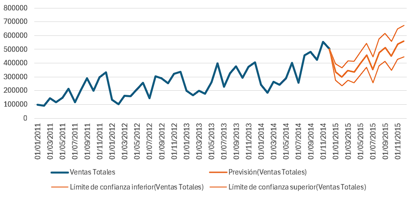

# Tablas dinámicas en Excel

Libro conectado en vivo al modelo de Analysis Services (Datos → Obtener datos → De Analysis Services), con nueve hojas:

| Hoja | Contenido |
|---|---|
| 1_Categoria_Anio | Ventas, ganancia y margen por categoría y año |
| 2_Banda_Categoria | Ganancia por banda de descuento y categoría |
| 3_Top20_Perdida | Los 20 productos con más pérdida |
| 4_Pais_Subcategoria | Ganancia por país y subcategoría con escala de color |
| 5_Segmentacion | Segmentaciones por mercado, año y segmento |
| 6_Pronostico / 7_Grafico_Pronostico | Pronóstico 2015 con `PRONOSTICO.ETS` e intervalo de 95 % |
| 8_Simulador_Tope | Parámetro Tope Descuento y medidas simuladas |
| 9_Escenario_2015 | Ganancia 2015 con y sin política según el volumen retenido |

