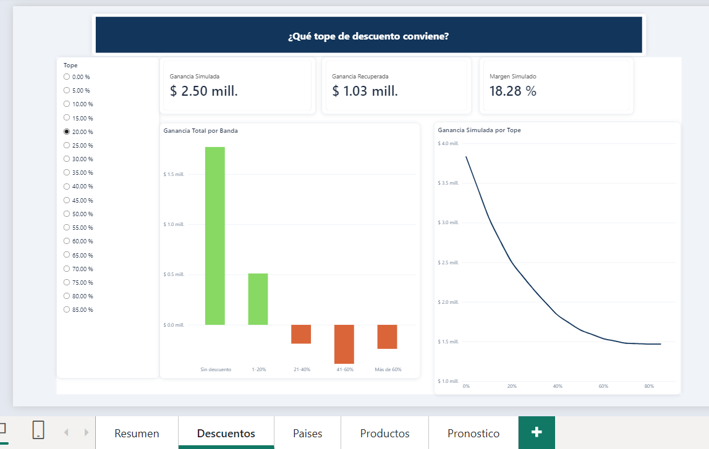

# Tablero en Power BI

Tablero de 5 páginas conectado **en vivo** al modelo de Analysis Services (los datos no se copian al `.pbix`; las medidas se calculan en el servidor).

| Página | Qué responde |
|---|---|
| Resumen | Cómo va el negocio: ventas, ganancia, margen y % de líneas con pérdida |
| Descuentos | Qué tope de descuento conviene y cuánto se recupera (segmentador del parámetro Tope) |
| Países | Dónde se pierde dinero (mapa coloreado y top 10 de pérdidas) |
| Productos | Qué subcategorías pierden y con qué nivel de descuento |
| Pronóstico | Tendencia de ventas 2015 (referencial) |

`Tema_Rentabilidad_Pulido.json` es el tema visual personalizado (Vista → Temas → Examinar temas): paleta azul marino, verde azulado, naranja y coral, tarjetas con barra de acento y tablas con encabezado azul marino.

> Para abrirlo en otra computadora: Inicio → Transformar datos → Configuración de origen de datos, y apuntar al servidor de esa computadora. Los mapas se activan en Archivo → Opciones → Seguridad.

