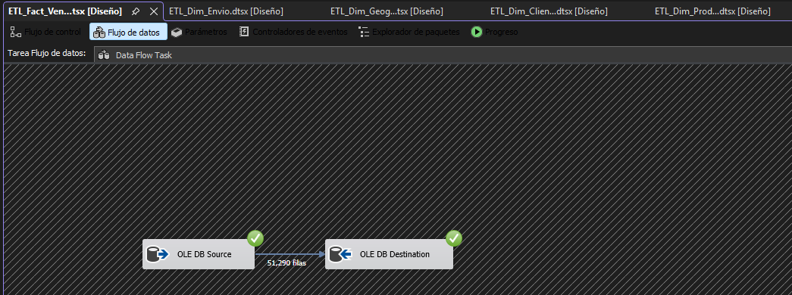

# ETL con SSIS · ETL_DataMart_Rentabilidad

Abre `ETL_DataMart_Rentabilidad.slnx` en Visual Studio (con la extensión SQL Server Integration Services Projects).

Proyecto Integration Services en Visual Studio con dos conexiones OLE DB (origen `Superstore_Normalizado`, destino `DataMart_Rentabilidad`) y un paquete por tabla. Cada paquete vacía la tabla destino con una tarea **Ejecutar SQL** antes de cargarla, para poder ejecutarse varias veces sin duplicar datos.

| Paquete | Filas | Consulta de origen |
|---|---:|---|
| ETL_Dim_Producto | 10,768 | [ETL_Dim_Producto.sql](../sql/etl_origenes/ETL_Dim_Producto.sql) |
| ETL_Dim_Cliente | 1,590 | [ETL_Dim_Cliente.sql](../sql/etl_origenes/ETL_Dim_Cliente.sql) |
| ETL_Dim_Geografia | 3,847 | [ETL_Dim_Geografia.sql](../sql/etl_origenes/ETL_Dim_Geografia.sql) |
| ETL_Dim_Envio | 16 | [ETL_Dim_Envio.sql](../sql/etl_origenes/ETL_Dim_Envio.sql) |
| ETL_Fact_Ventas | 51,290 | [ETL_Fact_Ventas.sql](../sql/etl_origenes/ETL_Fact_Ventas.sql) |

`ETL_Fact_Ventas` se ejecuta al final, porque necesita las dimensiones cargadas para traducir los identificadores a llaves sustitutas.

> El proyecto usa autenticación de Windows (`Integrated Security=SSPI`) contra `localhost`, por lo que no guarda usuarios ni contraseñas. Su nivel de protección es `DontSaveSensitive`, el recomendado para control de versiones.
